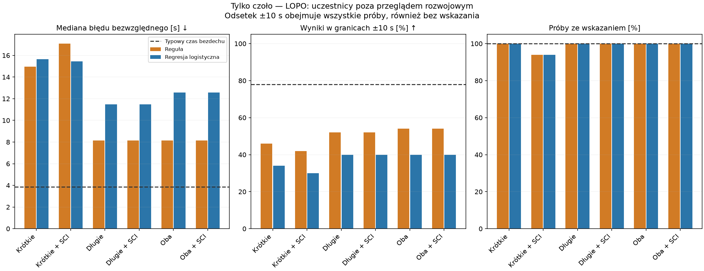

# BreathBack — wyniki pilotażowe, tylko czoło

Analiza 28 nagrań ze zbioru fNIRS High-Frequency Supine. Oceniono 56 bezdechów
z końcem oznaczonym markerem eksperymentalnym; pozostałe 28 służy tylko do
demonstracji, bez oceny trafności. To nie jest pomiar pierwszego wdechu ani
narzędzie diagnostyczne.

## Wybór kanałów

Zachowano wyłącznie pary, których źródło i detektor leżą najbliżej nominalnych
punktów Fp/AFp/AF w SNIRF (odległość do najbliższego landmarku do 25 mm).
Wykluczono AFF, pozostałe F oraz FC. Filtr jest zdefiniowany z góry i nie
dobierano go do wyników oceny.

We wszystkich nagraniach pozostało 6 par: S5–D3, S5–D4, S6–D4, S6–D5, S7–D4,
S8–D5, czyli 4 długie i 2 krótkie, łącznie 12 przebiegów dla dwóch długości fal.
Współrzędne w pliku opisują nominalny montaż, nie potwierdzają faktycznego
ułożenia czepka.

## Ocena

Zewnętrzne leave-one-person-out: wszystkie próby ocenianej osoby są poza
treningiem. Parametry, próg SCI i korekta opóźnienia są dobierane wewnętrznym
3-częściowym podziałem grupowym. Obszar poszukiwań zależy tylko od początku
bezdechu i końca nagrania, nie od jego referencyjnego zakończenia.

Poniższe liczby dotyczą wszystkich 56 oznaczonych prób:

| Metoda | Mediana błędu bezwzględnego | Trafienia ±10 s | Pokrycie |
|---|---:|---:|---:|
| Typowy czas bezdechu osób treningowych | 4,33 s | 75,0% | 100% |
| Reguła, oba rodzaje kanałów | 8,56 s | 51,8% | 100% |
| Reguła, oba rodzaje + kontrola jakości | 8,56 s | 51,8% | 100% |
| Regresja logistyczna, oba rodzaje + kontrola jakości | 11,68 s | 41,1% | 100% |

**Żaden z badanych detektorów sygnałowych nie pokonał metody odniesienia.**
Dobór najlepszego wariantu po obejrzeniu wyników nie stanowi niezależnej
walidacji. Kontrola jakości nie daje spójnej poprawy; dla krótkich kanałów
spowodowała 3 odmowy wskazania na 56 prób (pokrycie 94,6%).

Wykres pokazuje 50 prób po wyłączeniu trzech osób użytych do przeglądu
krótkiego, średniego i długiego bezdechu. Ten podzbiór nie jest losowy i ma
węższy rozkład czasów. Pełne wyniki dla obu zakresów zawiera [metrics.csv](metrics.csv).
Odsetki trafień obejmują wszystkie próby, także bez wskazania; błędy są liczone
wśród dostępnych predykcji.

## Ograniczenia i odtwarzanie

- Mały zbiór: 28 niezależnych uczestników, dwa oznaczone zakończenia na osobę.
- Filtracja dwukierunkowa i okna po kandydacie wymagają przyszłego sygnału:
  metoda działa offline.
- Markery są referencją eksperymentalną, bez niezależnego pomiaru oddechu.
- Nie ma podstaw do diagnozowania chorób lub określania wydolności fizycznej.
- Włosy, wiek i aktywność nie są wejściami modelu. Analiza ich związku z błędem
  detektora ma charakter eksploracyjny.

Odtworzenie: [instrukcja](../breathback/README.md). Uruchomienie tworzy lokalny
raport, predykcje, modele, audyt podziałów i wybór kanałów. Testy obejmują
oddzielenie uczestników oraz niezależność cech od referencyjnego końca i od
wykluczonych sygnałów. Żadne dane pojedynczych uczestników nie są dołączone
do tego katalogu.
